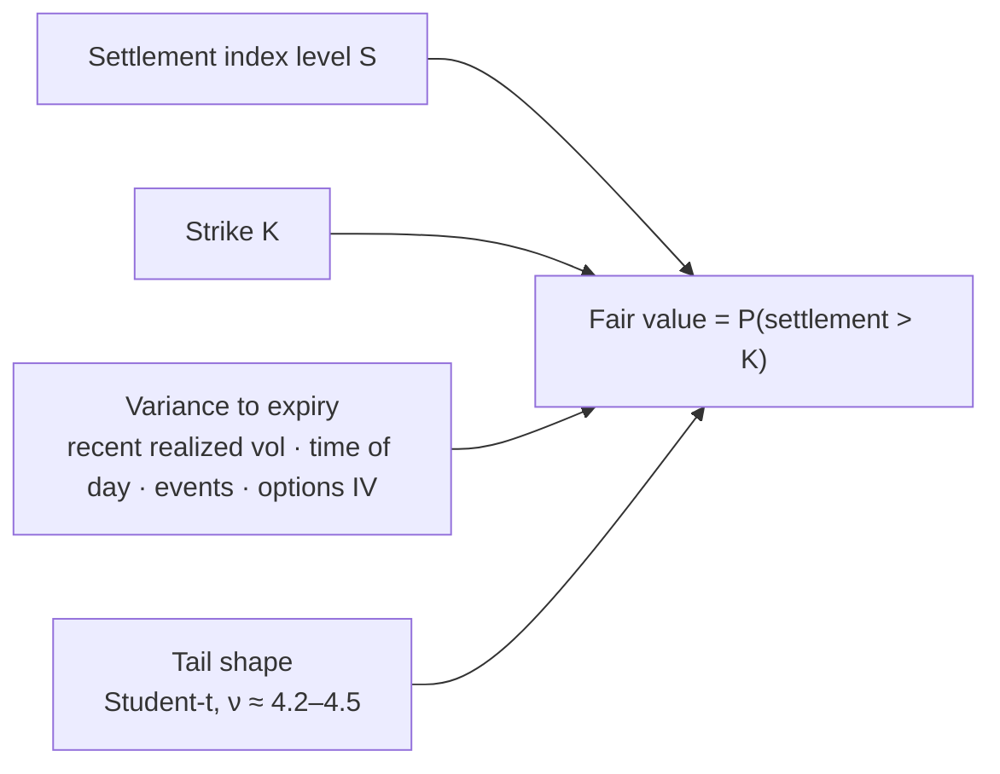

# 1. Pricing Crypto Prediction Markets, From Zero

This guide explains how to find the fair value of a crypto prediction-market contract, for a reader who knows options or sports pricing but not crypto. Every number marked **[Tested]** comes from this repo's studies (`make results`, outputs in [`docs/results/`](results/), write-up in [`06_RESULTS.md`](06_RESULTS.md)). **[Source]** marks rulebooks, venue documentation and papers. **[Judgment]** marks reasoned views that are not tested here.

Reading order: this guide → [`02_MARKET_SIGNALS.md`](02_MARKET_SIGNALS.md) (spot and derivatives inputs) → [`03_SENTIMENT_AND_NEWS.md`](03_SENTIMENT_AND_NEWS.md) → [`04_MARKET_MAKING.md`](04_MARKET_MAKING.md) → [`05_SYSTEM_ROADMAP.md`](05_SYSTEM_ROADMAP.md) → [`06_RESULTS.md`](06_RESULTS.md). Terms are defined in [`GLOSSARY.md`](GLOSSARY.md).

---

## 1.1 What is being priced

A Kalshi contract like "BTC above $80,000 at 5 PM ET" pays $1 if true and $0 if not. In options terms it is a **cash-or-nothing digital option** on bitcoin. Prices are quoted in cents, and **the price is the market's probability**: 63¢ means 63%.

The main contract families:

| Contract | Pays $1 if | Options analogue |
|---|---|---|
| Above/below ladder (hourly, daily) | Settlement > strike, for each of ~150 strikes | A strip of digital calls |
| Range bucket | Settlement lands between two strikes | Digital call spread |
| 15-minute up/down | Settlement at the end ≥ settlement at the start | At-the-money digital, struck at the opening level |
| Max/min ("touch") | Price touches a level before expiry | One-touch barrier |
| Long-dated (monthly, year-end) | Same payoffs, months out | Long-dated digitals, hedgeable with listed options |

**Fair value is the probability that the settlement value finishes on the paying side**, measured so that a market maker could defend it: it matches the market's accuracy, and it can be hedged.

---

## 1.2 Why crypto is a good fit for quantitative pricing (and where it isn't)

Bitcoin has no earnings, cash flows or balance sheet. Over the minutes-to-days horizon of these contracts, its price is driven by **flows, leverage, liquidity, macro risk appetite and news**. That changes how pricing works compared with a stock:

| Feature | What it means for pricing | Evidence |
|---|---|---|
| **No fundamental anchor at short horizons** | Fair value is a statement about the *distribution of moves*, not about what bitcoin is "worth". Drift is zero at these horizons; the work is forecasting how much it moves | Positioning and flow variables have no out-of-sample directional power at 1h, 4h or 24h [Tested] |
| **One dominant factor** | ETH and SOL behave like leveraged BTC. One volatility engine plus betas covers the whole complex | ETH β ≈ 1.2 to BTC with R² 0.74–0.82; SOL β ≈ 1.25, R² 0.65–0.76; in BTC's biggest hours, both moved the same direction 100% of the time [Tested] |
| **Everything is observable, 24/7** | Order books, perpetual futures, open interest, funding and options are public and granular. The market's state can be measured, not guessed | All data in this repo is free and public [Tested] |
| **Transparent settlement index** | Contracts settle on a published index (CF Benchmarks BRTI for Kalshi) that can be rebuilt from exchange data | A free two-exchange proxy tracks the settlement to 1.2 bp median [Tested] |
| **Macro sensitivity** | BTC trades as a risk asset. US data releases move it sharply | Variance in the 5 minutes after CPI, payrolls or FOMC runs 7–21× the normal forecast [Tested] |

So crypto is **technically tractable, not easy**. The same features that make it quantitative also make it dangerous:
- **Volatility is high.** BTC runs about 45% annualized, versus roughly 15–20% for the S&P 500 [Tested for BTC].
- **Tails are fat.** Standardized 15-minute returns have excess kurtosis near 10 [Tested]. A normal distribution misprices strikes by several cents.
- **It never closes.** There is no overnight to reset risk, and weekends trade thin.
- **News hits as jumps.** Policy posts, hacks and regulatory headlines arrive on social media first. The October 10, 2025 tariff post set off a reported ~$19B liquidation cascade [Source; see [`03_SENTIMENT_AND_NEWS.md`](03_SENTIMENT_AND_NEWS.md)].
- **Thin-hour manipulation.** Pushes around settlement prints are documented, especially on point-price contracts and small coins [Source].

---

## 1.3 The three numbers that set fair value

Fair value depends on three things:

1. **Distance**: the current settlement-index level versus the strike.
2. **Room to move**: how far the index can travel before settlement. That is volatility × √(time left), reduced by how the contract averages its settlement.
3. **Shape**: how moves are distributed. Crypto needs fat tails.

Everything else (open interest, funding, options, sentiment) matters only through one of these, almost always #2. **No input is a "weight" added to the price.** Inputs feed the volatility forecast; the forecast feeds one probability formula.

---

## 1.4 Step 1: read the settlement rule

Most avoidable losses on these venues come from pricing the wrong thing. Answer these before modeling anything:

| Question | Why it matters | Kalshi BTC (verified) |
|---|---|---|
| Which index? | Indices differ by several basis points at the same moment | CF Benchmarks BRTI: seven USD exchanges, computed every 200 ms [Source] |
| Average or single print? | An average removes variance in the final minute and is harder to push | Mean of 60 one-second BRTI prints before expiry [Source] |
| Quote currency? | USDT and USD differ by a small, moving basis | USD. Binance BTC/USDT sat about +5 bp above BRTI in our data [Tested] |
| Tie rule? | Decides the contract when the average lands on the strike | 15-minute: a tie pays YES (≥) [Source] |
| Strike convention? | "79,999.99" means "≥ 80,000" in practice | Ladders list X − 0.01 [Source] |
| Timezone and pauses? | Contracts are defined in ET; data arrives in UTC; DST shifts the mapping | Trading pause Thursdays 3–5 AM ET [Source] |
| Fees? | They set the break-even for both sides | Taker pays ceil(0.07·C·P(1−P)), 1.75¢ at 50¢; **no maker fee** on these series (API `fee_type: quadratic`) [Source] |

**What getting this wrong costs:** a common setup prices Kalshi's 15-minute market off Binance's BTC/USDT price, with recent volatility and a normal distribution. In our test it averaged **21¢ away from the market** and scored far worse than every model that used the right index [Tested]. Getting the index right is the first and largest edge.

---

## 1.5 Step 2: replicate the index

BRTI is computed from the order books of Coinbase, Kraken, Bitstamp, Gemini, LMAX Digital, Bullish and Crypto.com, using USD pairs only [Source]. The method caps size at each price level, takes a depth-weighted mid of the combined book, and drops stale or outlying exchanges.

- **In production:** subscribe to all seven order books, recompute every 200 ms, and validate against Kalshi's own live BRTI stream.
- **In this repo:** the median of Coinbase and Bitstamp one-minute closes, plus a +0.38 bp offset fit on training data. It tracks the official settlement to 1.2 bp median and 5.8 bp at the 95th percentile [Tested].

---

## 1.6 Step 3: forecast variance for the exact minutes left

Volatility is the input that actually has to be forecast. Our forecast has three parts:

1. **Level.** A regression (log-HAR) on realized variance over the last 1 hour, 24 hours and 7 days, plus Deribit's DVOL (30-day options-implied vol). The weights shift toward slower inputs as the horizon lengthens [Tested]:

   | Input | Weight, next hour | Weight, next 24h |
   |---|---|---|
   | Realized variance, last 1h | 0.52 | 0.17 |
   | Realized variance, last 24h | 0.35 | 0.38 |
   | Realized variance, last 7d | 0.01 | 0.14 |
   | DVOL (options-implied) | 0.30 | 0.40 |

2. **Time of week.** Variance follows a strong US-hours pattern. A 15-minute window at 10 AM ET is not the same contract as one at 3 AM [Tested]:

   | ET window (weekdays) | Variance vs average |
   |---|---|
   | Midnight–7 AM | 0.55–0.73× |
   | 9–10 AM (US equity open at 9:30) | 2.6× |
   | 10–11 AM | 3.0× |
   | 11 AM–1 PM | 1.7–2.1× |
   | Weekends | 0.67× |

3. **Scheduled events.** CPI, payrolls and FOMC concentrate variance into minutes. The first 5 minutes after a release run 7.5× the normal forecast on average across releases, and the following hour about 2.1× [Tested].

---

## 1.7 Step 4: adjust for averaged settlement

Kalshi settles on a 60-second average, so the last minute contributes about a third of the variance a single print would. Before the window opens, subtract 0.658 of the final minute's variance (the exact value for 60 prints, checked by Monte Carlo in the test suite). Inside the window, the prints already locked in define an effective strike for the remaining ones.

**Effect:** on 15-minute contracts in the final minute, the model's average gap to the Kalshi mid falls from 13.3¢ to 8.8¢ [Tested]. Beyond about 10 minutes, the adjustment doesn't matter.

---

## 1.8 Step 5: use fat tails

Replace the normal with a Student-t scaled to the same variance. The fitted ν is 4.5 for 15-minute horizons and 4.2 for 1-hour horizons [Tested]. This was the **largest single improvement** in the model [Tested]:
- **Hourly:** the gap to the Kalshi mid shrank from 1.3 to 0.3 thousandths of Brier score.
- **Cheap strikes:** on contracts 0.5–1.5σ out of the money, a normal model overprices by about 4–5¢ relative to what they actually paid. The t-model sits within about 1–1.5¢.

For weekly and longer contracts, take the tails from the options smile instead (§1.11).

---

## 1.9 Step 6: price everything from one distribution

The whole ladder (P above each strike), range buckets (differences between strikes) and up/down contracts come from **one** terminal distribution per expiry. That makes prices fall monotonically with strike and makes buckets sum to one, so nobody can arbitrage the quotes against each other.

### Worked example: a 15-minute contract

It is 3:10 PM in a 3:00–3:15 window. The start price was $80,000, BTC is at $80,060, and volatility is 45% a year (0.062% per minute).

| Step | One-sigma move | Fair value of YES |
|---|---|---|
| Normal, single-print settlement | $111 | 70.5¢ |
| + 60-second averaging | $104 | 71.9¢ |
| + fat tails (ν = 4.5) | $104 | **76.2¢** |
| Same, but volatility doubles (a data release) | $207 | 64.2¢ |
| Same, but 2 minutes left | $58 | 88.7¢ |

### Worked example: an hourly strike

Strike $80,400 with BTC at $80,060 and 40 minutes left:
- A normal distribution gives 14.0¢.
- Fat tails give 10.3¢.
- If those 40 minutes are the 10–11 AM ET hour (about 3× variance), fair value rises to **21.8¢**. Time of day alone is worth 11¢ on this contract.

---

## 1.10 Different tenors depend on different things

The recipe never changes, but which input dominates does.

| Tenor | What dominates | Sensitivity to a 1 bp BTC move (at the money) | Our model vs the Kalshi mid [Tested] |
|---|---|---|---|
| **15-minute** | Exact index level, sub-second; averaging in the last minutes | ~1.5¢ (15 min left) to ~6¢ (final minute) | Behind: 4.3¢ average gap |
| **Hourly** | Variance forecast, time of day, releases | ~0.75¢ | Tied |
| **Daily** | Variance level, tails, options IV | ~0.15¢ | Slightly ahead (small sample) |
| **Weekly to year-end** | The options-implied distribution, discounting, the crowd | negligible | Not tested; method in §1.11 |
| **Touch / barrier** | Path: volatility, vol-of-vol, jumps, monitoring rule | – | Not tested; method in §1.12 |

**Short tenors are a measurement problem; long tenors are a distribution problem.** At 15 minutes, being 1 bp wrong about the index costs more than any modeling choice. At one day, the shape and width of the distribution decide everything.

**Why the 15-minute gap exists.** We inverted every 15-minute quote for the index level the market must be using [Tested]:
- The implied level differs from our proxy by 0.9 bp at the median, about the size of the proxy's known error.
- The hourly ladder, a separate market, implies a correlated difference at the same minute (correlation 0.34).
- But the gap also grows with strike distance, which points to the market also reading short-term volatility faster than a one-minute model can.

The honest conclusion: **sub-second index replication is necessary for 15-minute markets but probably not sufficient**. A second-by-second volatility read is the other half.

---

## 1.11 Long-dated contracts: price from options

For contracts expiring in weeks or months, the options market already prices the full distribution.

1. **Read the digital off the smile.** "BTC above K on date T" ≈ a tight call spread around K. Its price is −∂C/∂K, which with skew is N(d₂) − vega·∂σ/∂K (Breeden–Litzenberger).
2. **Match the settlement time.** Deribit expires at 08:00 UTC on a 30-minute average; Kalshi's daily settles at 5 PM ET on a 60-second average [Source]. Interpolate total variance to the exact time. The hedge is close, not exact.
3. **Account for capital.** Kalshi pays variable interest (currently 3.5% APY) on cash *and* the value of open positions [Source]. That offsets much of the cost of tying up capital, but the hedge leg on Deribit or a perp has its own funding cost.
4. **Account for frictions.** Fees, position limits ($25k per strike on Kalshi [Source]) and the fact that most buyers cannot hedge in options.
5. **Trade the gap.** If the venue price departs from the hedged fair value by more than those frictions, trade it and hedge with options. This is an options relative-value trade, and it is where crowd sentiment matters ([`03_SENTIMENT_AND_NEWS.md`](03_SENTIMENT_AND_NEWS.md)).

Note that options-implied volatility alone is a poor short-tenor price. A Black-Scholes digital using DVOL as volatility scored worse than our model at every tenor, and worse than the Kalshi mid [Tested]. DVOL is a 30-day number; it says little about the next 15 minutes.

---

## 1.12 Touch markets

"Does BTC hit $X before date T?" is a barrier option. With zero drift and continuous monitoring, P(touch) ≈ 2 × P(finish above X). Real pricing needs three corrections:
- **Discrete, trimmed monitoring.** Kalshi measures each minute with a 20%-trimmed mean, so a wick under about 12 seconds cannot trigger it. That lowers the touch probability [Source].
- **Fat tails and vol-of-vol** raise touch probabilities far from spot.
- **Method.** Price by Monte Carlo under a model calibrated to the smile, applying the venue's exact monitoring rule.

---

## 1.13 Venues differ by settlement source

| Venue | Settlement | Implication |
|---|---|---|
| **Kalshi** | BRTI, 60-second average [Source] | BRTI replica |
| **Polymarket US** (CFTC-regulated) | BRTI, 60-second average, per its exchange's CFTC filings [Source, secondary] | Same engine as Kalshi |
| **Polymarket international, 5m/15m/4h** | Chainlink BTC/USD 60-second TWAP at the end, compared with "the price at the beginning" of the window. Before mid-2026 it compared two single Chainlink prints [Source] | Separate Chainlink replica and a BRTI–Chainlink basis model. Backtests must handle the rule change. US persons cannot trade this venue |
| **Polymarket international, hourly** | Binance BTC/USDT 1-hour candle, close ≥ open [Source] | A point print on one USDT exchange: model the USDT basis and widen near the close, where pushes are cheapest |
| **ForecastEx (Interactive Brokers)** | CF RTI, 60-second averages [Source] | Same as Kalshi 15-minute |

**One engine, several index replicas.** The volatility forecast and distribution are shared. Each venue gets its own replica and a basis model between them, so one risk book can net positions across venues.

---

## 1.14 How this compares with how others price these markets

| Approach | Who uses it | Result in our test [Tested] |
|---|---|---|
| **Binance price + recent vol + normal** | Common in public bot code | Far worse than everything else. 15-minute Brier 0.245 vs 0.165 for ours, because the USDT index is the wrong one |
| **Options-implied (Black-Scholes digital with DVOL)** | Common first attempt by options traders; several public tests | Worse than ours at every tenor (95% intervals exclude zero) and worse than the mid. Consistent with public tests that found options-implied fair value loses to the Kalshi mid [Source] |
| **This repo's model (v4)** | – | Ties the mid on hourly, slightly ahead on daily, behind on 15-minute |
| **The Kalshi mid** | The market, with SIG and other designated market makers quoting [Source] | The benchmark. Already efficient on hourly and daily |
| **Designated market makers' internal models** | SIG, others (not public) | Unknown. They are likely options-style books with sub-second index replication [Judgment] |

**The point:** the free, first-principles model matches the market where retail flow is heaviest (hourly and daily), and it beats the public approaches by a wide margin. That is the bar for quoting safely. The money then comes from market making, not from out-forecasting the market ([`04_MARKET_MAKING.md`](04_MARKET_MAKING.md)).
