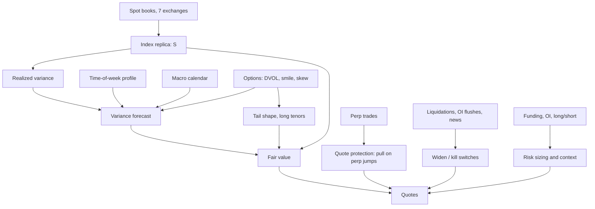

# 2. Spot and Derivatives Signals: What Each One Tells You

A prediction contract is a derivative of the spot index, so everything happening in spot and in the derivatives built on it bears on its fair value. This document goes through each metric a crypto desk watches: what it is, what it tells you, how it enters the pricer, and what our data says about it. Tags follow [`01_PRICING_GUIDE.md`](01_PRICING_GUIDE.md): [Tested], [Source], [Judgment].

**Summary:**
- Spot and realized volatility set the price.
- Options set the volatility level for longer tenors.
- Perpetual futures give a speed advantage for protecting quotes.
- Positioning metrics (open interest, funding, long/short ratios) explain *why* a move happened and help size risk, but in our data they **did not forecast** direction or next-hour volatility once price and realized volatility were known.

---

## 2.1 The metrics at a glance

| Metric | What it is | What it tells you | Role in pricing | What our data says |
|---|---|---|---|---|
| **Settlement index** (BRTI) | The price the contract settles on | Where we are | **S** in the formula | Free proxy tracks it to 1.2 bp [Tested] |
| **Realized volatility** | How much the index actually moved, last 1h/24h/7d | Current regime | Main input to the variance forecast | Largest weights in the forecast [Tested] |
| **Time-of-week pattern** | Average variance by ET half-hour | When moves happen | Scales the forecast to the exact minutes left | US open runs about 3× average variance [Tested] |
| **Perpetual futures price** | Price of the most-traded BTC derivative | Where spot is about to go, a fraction of a second early | Quote protection: pull quotes when the perp moves | Leads Binance spot mostly within 100–300 ms; explains about 2% of the next second of spot [Tested] |
| **Perp basis** | Perp price minus spot | Leverage demand | Regime indicator | Binance perp averaged 4.5 bp *below* spot in the test period [Tested] |
| **Funding rate** | Periodic payment between perp longs and shorts | Who is paying to hold leverage | Possible jump-risk input | No directional power; no added volatility information [Tested] |
| **Open interest (OI)** | Total open perp contracts | How much leverage is in the system | Risk sizing; liquidation context | No directional or volatility power beyond realized vol [Tested] |
| **OI change × price change** | The "OI story" (below) | Whether moves come from new positions or closing ones | Context | No quadrant predicted the next 4 hours [Tested] |
| **Liquidations** | Forced closing of leveraged positions | Cascades in progress | Live kill-switch input | The big cascade was triggered by news, not foreshadowed by positioning [Tested] |
| **Long/short ratios** | Share of accounts or top traders net long | Crowd positioning | Context | No predictive power [Tested] |
| **Taker buy/sell volume** | Aggressive buying vs selling | Short-term pressure | Context; quote skew at very short horizons | No predictive power at 1h+ [Tested] |
| **Options implied vol** (DVOL, ATM IV) | The options market's volatility price | Expected volatility, 30 days out | Volatility level, mainly for daily and longer | Weight 0.30 (next hour) to 0.40 (next day) in the forecast [Tested] |
| **Options skew** (25-delta risk reversal) | Price of downside vs upside protection | Where the options market sees tail risk | Tail asymmetry for daily and longer | Not tested; standard input for long tenors [Judgment] |
| **IV term structure** | Implied vol by expiry | Event risk priced at specific dates | Volatility for each contract's exact date | Not tested; standard practice [Judgment] |
| **CME futures and weekend gaps** | Regulated futures, closed on weekends | Institutional positioning; weekend-gap behavior | Context | Not tested |
| **Coinbase premium** | Coinbase USD price vs offshore USDT price | US-specific demand | Slow regime indicator | Not tested |
| **ETF flows, stablecoin supply, exchange on-chain flows** | Daily capital flows | Slow-moving demand | Long-dated crowd and regime models | Not tested; see [`03_SENTIMENT_AND_NEWS.md`](03_SENTIMENT_AND_NEWS.md) |
| **Alt-coin beta** | ETH and SOL sensitivity to BTC | How the complex co-moves | Price ETH and SOL contracts from BTC vol × beta, plus a residual | ETH β 1.2 (R² 0.74–0.82); SOL β 1.25 (R² 0.65–0.76) [Tested] |
| **Macro calendar** | CPI, payrolls, FOMC times | Scheduled variance spikes | Event variance bumps | First 5 minutes carry about 6.3× forecast variance (pooled, fit on training releases, relative to non-release days) [Tested] |

---

## 2.2 Spot: the attributes the contract inherits

The contract's fair value is built from four properties of the spot index:

1. **Level.** The distance to the strike. It must be measured on the settlement index. Pricing Kalshi's 15-minute market naively off Binance's USDT price (median +4.9 bp away from BRTI at hourly settlements) missed the market by 21¢ on average [Tested].
2. **Volatility.** How fast the level moves. BTC runs about 45% annualized; ETH 61% and SOL 68% in the same period [Tested].
3. **Seasonality.** Moves cluster in US hours and around data releases. Weekends are quiet.
4. **Tails.** Big moves are far more common than a normal distribution implies. Excess kurtosis of standardized 15-minute returns is about 10 [Tested].

Each of these is measured from public, 24/7 data. That is why crypto prediction markets are a numbers-driven pricing problem.

---

## 2.3 Perpetual futures: the market's fastest signal

A **perpetual future (perp)** is a futures contract with no expiry. A **funding rate**, paid between longs and shorts every few hours, keeps it near spot. Perps carry most of crypto's trading volume and leverage.

**Lead over spot.** Binance's BTC perp vs Binance spot, 100 ms returns, three weekdays in October 2026 [Tested]:

| Lag | Correlation |
|---|---|
| Perp moves 100 ms *before* spot | 0.18 |
| Same 100 ms | 0.62 |
| Spot moves 100 ms *before* perp | 0.09 |

- About 69% of the lead-lag correlation sits on the side where the perp moves first.
- The last second of perp-minus-spot movement explains about 1.7% of the next second of spot.

This is consistent with research finding that crypto derivatives venues dominate price discovery (Alexander & Heck, 2020, on BitMEX, Huobi and OKEx) [Source].

**What this means:**
- A 100–300 ms head start is worth nothing for fair value over 15 minutes.
- It is worth a lot for **not getting picked off**. When the perp jumps, a market maker's resting quotes are about to be stale. Pulling them on the perp tick, before the index catches up, is the main use of perp data.

---

## 2.4 Open interest: the story it tells, and its limits

**Open interest** is the number of perp contracts outstanding. Each has a long and a short, so OI measures how much leverage is in the system, not its direction. Traders read OI together with price.

| Last hour | Usual reading | What followed in our data (4-hour return, t-stat) [Tested] |
|---|---|---|
| Price up, OI up | New longs opening, leverage building | +1.8 bp (t = 0.4) |
| Price up, OI down | Shorts covering, a squeeze | +11.9 bp (t = 1.1) |
| Price down, OI up | New shorts opening | −13.0 bp (t = −1.3) |
| Price down, OI down | Longs exiting or being liquidated | −6.0 bp (t = −1.3) |
| *All hours (baseline)* | – | −1.9 bp |

None of these is statistically different from zero. **The OI story is a good description of what just happened, not a forecast.**

Other tests on the same data, all fit before May 2026 and scored on May–October 2026 (4,269 test hours) [Tested]:

| Question | Result |
|---|---|
| Do OI, funding, basis, long/short ratios or taker flow predict BTC's next 1h, 4h or 24h return? | No. Out-of-sample R² is −0.4% (1h), −2.0% (4h) and −10.8% (24h). Worse than predicting zero |
| Do they improve the next-hour volatility forecast beyond realized vol, time of week and DVOL? | No. The base forecast explains 63% of next-hour log variance; positioning adds nothing (−4% R² on the residual) |
| Is the downside tail fatter when longs are crowded (high funding, rising OI, top traders long)? | Not meaningfully, in this sample. With terciles set on training data, 4-hour drops beyond 2σ happened 1.8% of the time in the most crowded third vs 1.4% in the least crowded. Large up-moves were more common when crowded (3.1% vs 1.9%) |

**A methodology note.** A first pass found a small signal: last-hour OI change predicting the next hour, R² 0.9%. It vanished when OI snapshots were time-stamped 5 minutes later to rule out any overlap with the forecast window. Positioning data is easy to leak, and timestamps have to be handled conservatively.

### Case: the October 10–11, 2025 liquidation cascade

The largest liquidation event on record (reported at ~$19B across exchanges, set off by a US tariff announcement on China [Source]), hour by hour on our data:
- **Before the crash, positioning looked ordinary.** OI was 0.8 standard deviations above its 30-day mean and funding was a normal 0.4 bp. Nothing flagged a cascade.
- **The first leg (14:00–17:00 UTC) came as the first tariff headlines hit.** BTC fell about 2.9% over three hours; OI fell about 5%.
- **The crash hour (21:00–22:00 UTC):** realized one-hour volatility was 334 bp against a forecast of 119 bp (2.8×). OI fell 18.6% in that hour and 37.7% over 24 hours. BTC was down about 9% on the day [Tested; a single case study, not a statistical test].

**Lesson:** news triggered the move and leverage amplified it. Positioning did not predict it, but a live liquidation and OI feed **identifies a cascade while it is happening**. That makes it a kill-switch and widening input, not a pricing input.

---

## 2.5 Funding and basis

- **Funding rate.** Averaged 0.44 bp per 8 hours in the test period (about 4.8% annualized, longs paying shorts) [Tested]. It moves slowly and carried no directional or volatility information at our horizons. An earlier check found a −0.02 correlation with the next 8-hour return.
- **Basis.** Binance's perp traded on average 4.5 bp below Binance spot [Tested]. That matters for **hedging**: a perp hedge carries a basis that has to be priced in.
- **Research context.** He, Manela, Ross & von Wachter (*Fundamentals of Perpetual Futures*) show perp deviations from their no-arbitrage value are large and comove across coins, and that arbitraging them is profitable [Source]. That is an edge for a perp desk, not a prediction-market pricing input.

---

## 2.6 Options

Options are the one derivatives market that prices the *distribution*, not just the level.

- **DVOL / at-the-money IV.** A 30-day volatility. It carries real weight in the daily forecast (0.40) and less for the next hour (0.30) [Tested]. On its own it is a poor short-tenor price: a Black-Scholes digital using DVOL lost to our model at every tenor [Tested].
- **The market prices slightly more volatility than gets realized.** The vol level that best fits the Kalshi mid is 1.00–1.06× our forecast. The level that best fits outcomes is 0.92–0.96× (both fit on the test period, so this is descriptive) [Tested]. A two-sided digital book is not simply short volatility, because higher volatility raises out-of-the-money digitals and lowers in-the-money ones. What the premium means in practice is that the book's far strikes are slightly rich, which is the same longshot premium described in [`03_SENTIMENT_AND_NEWS.md`](03_SENTIMENT_AND_NEWS.md).
- **Skew and term structure** become primary for weekly and longer contracts (§1.11 of the pricing guide).

---

## 2.7 Alt-coins: one factor plus a residual

Kalshi and Polymarket also list ETH, SOL, XRP and others. Measured on our data [Tested]:

| | β to BTC (1h) | R² (1h) | R² (1d) | Annualized vol |
|---|---|---|---|---|
| ETH | 1.21 | 0.79 | 0.82 | 61% |
| SOL | 1.26 | 0.70 | 0.76 | 68% |
| BTC | 1 | 1 | 1 | 45% |

- **Beta holds in big moves.** In BTC's top 1% of hours, both coins kept a beta of about 1.2 and moved in BTC's direction every time.
- **Pricing.** An alt contract's variance = β² × BTC variance + residual variance. This lets one book net BTC and alt exposure.
- **Risk.** In a crash every coin falls together, so diversification across coins is close to zero exactly when it's needed.
- **Caution.** Thinner alt books are easier to push around settlement, so widen those markets [Source: documented settlement pushes on Polymarket alt markets].

---

## 2.8 Where each signal goes in the system

**Rule of thumb:** a signal earns a place in **fair value** only if it improves out-of-sample accuracy. Signals that describe the market's state without forecasting it belong in **risk and quoting**: protection, widening, size limits.
