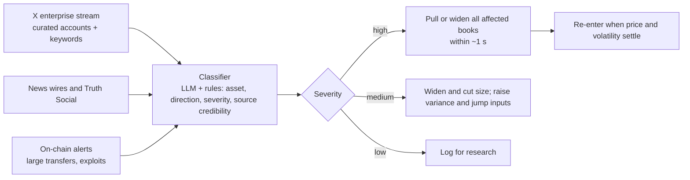

# 3. Sentiment and News: Where They Create Edge

Crypto is unusual: its main newswire is a social network. Exchange listings, hacks, regulatory actions, ETF decisions, policy posts and protocol incidents usually appear on X (and for US policy, on Truth Social) before any wire service. This document covers three ways news and sentiment can create edge for a prediction-market maker, and what our data does and doesn't support. Tags follow [`01_PRICING_GUIDE.md`](01_PRICING_GUIDE.md).

| Use | Horizon | What it does | Evidence |
|---|---|---|---|
| **A. News defense** | Seconds | Detect market-moving posts and pull or widen quotes before the price moves | Strong logic plus documented cases; latency value is quantified below |
| **B. Crowd-error edge** | Hours to months | Lean against the side the crowd overpays, sized by sentiment | Longshot overpricing confirmed across 6,475 Kalshi events in 44 weeks [Tested]; the sentiment link is suggestive, not established |
| **C. Direction** | Days to weeks | Tilt fair value with sentiment | Not supported in our data at hourly to weekly horizons [Tested]; academic evidence is mixed |

---

## 3.1 A. News defense: the X feed as a risk system

### Why it matters

A market maker's main loss is being **picked off**: a resting quote becomes stale after the price moves, and a faster trader takes it. How much fair value moves per basis point of BTC, for an at-the-money contract (derivation in [`archive/RESEARCH_NOTES.md`](archive/RESEARCH_NOTES.md)):

| Time to expiry | Fair-value move per 1 bp of BTC |
|---|---|
| 1 day | 0.15¢ |
| 1 hour | 0.75¢ |
| 15 minutes | 1.5¢ |
| Final minute, point print | 5.8¢ |
| Start of the 60-second averaging window | ~10¢ |

A headline that moves BTC 1% (100 bp) in a minute moves every near-the-money 15-minute contract by tens of cents. A maker who pulls quotes **seconds before** the move, because the post was read and classified first, avoids most of that loss. One who learns from the price itself pays for it.

### Documented cases

- **Fake ETF approval, January 9, 2024.** The SEC's X account was hijacked and posted a false spot-ETF approval. BTC spiked roughly $1,000, then fell more than $2,000 when the SEC chair denied it, a swing of about 4–5% in minutes [Source]. **Lesson:** news defense must *widen and pull* on unverified headlines, not take a direction.
- **Tariff cascade, October 10, 2025.** US–China tariff posts set off the largest liquidation event on record, reported at about $19B [Source]. On our data, realized volatility in the crash hour was 2.8× the forecast, and perp open interest fell 18.6% in that hour. Positioning beforehand looked ordinary [Tested; see [`02_MARKET_SIGNALS.md`](02_MARKET_SIGNALS.md) §2.4].

### How it works

- **Sources.**
  - A curated list on X: exchanges, regulators and officials, central-bank and macro accounts, protocol teams, crypto news accounts, on-chain alert bots.
  - Wire services, and Truth Social for US policy.
  - Real-time access requires an X enterprise or streaming agreement. Pricing is negotiated and has changed repeatedly; public reports put enterprise access in the tens of thousands of dollars per month. Licensed social-data vendors are the alternative.
- **Classification.** A fast rules layer (watch-listed accounts plus keywords such as "hack", "exploit", "approve", "tariff", "halt") runs in parallel with an LLM that labels asset, direction, severity and credibility. Rules trigger defense instantly; the LLM refines the decision within seconds.
- **Action.** Defense first: pull or widen, cut size, and raise the variance and jump-intensity inputs ([`01_PRICING_GUIDE.md`](01_PRICING_GUIDE.md) §1.6). Re-enter as realized volatility normalizes.
- **Scheduled releases are already in the model.** CPI, payrolls and FOMC times are known. The first 5 minutes after a release carry about 6.3× the forecast variance (pooled, training releases, relative to non-release days) [Tested], and quotes widen before the release.

**What this edge is and isn't.** It is a loss-avoidance system, and it pays in every tenor. It is not a directional trading strategy. Racing news-trading bots to take liquidity is a crowded, low-margin game. A maker who simply isn't standing in front of the move keeps the spread it already earns.

---

## 3.2 B. Crowd error: sentiment in longer-dated markets

### The mechanism

In a 15-minute market, mispricing is corrected in seconds. Longer-dated markets ("BTC above $150k on Dec 31", "BTC hits $X this month") are different:
1. **Correcting the price ties up capital for months.** Most participants can't hedge with options, and position limits cap any one firm ($25k per strike on Kalshi) [Source].
2. **Buyers express narratives, not distributions.** People overweight small probabilities: the favorite-longshot bias (Snowberg & Wolfers, 2010) [Source].
3. **On Kalshi specifically,** buyers of contracts under 10¢ lose over 60% of their money, and makers earn more than takers (Bürgi, Deng & Whelan) [Source].

### What our data shows [Tested]

Cheap contracts (model under 30% and market under 50% for that side) on Kalshi hourly and daily ladders, Nov 2025–Oct 2026. Intervals resample whole weeks (44), because contracts in the same week share one price path:

| Side | Contract-minutes | Events | Crowd overpays by (mid − outcome) | 95% CI (by week) |
|---|---|---|---|---|
| Upside longshots (BTC must rise) | 657,696 | 6,470 | **2.0¢** | 0.5 to 3.5¢ |
| Downside longshots (BTC must fall) | 665,270 | 6,460 | **1.9¢** | 0.1 to 3.6¢ |

**Cheap contracts are overpriced by about 2¢ on both sides.** That is the edge a maker earns by selling longshots, provided its fair value is accurate. Our Student-t model prices these contracts within about 1–1.5¢ of what they actually paid, while a normal distribution overprices them by 4–5¢ [Tested].

**Does sentiment move the overpricing?** Split by two sentiment proxies [Tested]:

| Condition (previous day) | Downside longshots overpriced by | Upside longshots overpriced by |
|---|---|---|
| BTC's last 7 days: weakest third | −0.2¢ (−3.9 to 3.9) | 1.6¢ (−1.5 to 3.9) |
| BTC's last 7 days: strongest third | **3.6¢ (2.2 to 5.0)** | 2.3¢ (1.1 to 3.9) |
| Retail attention (Wikipedia pageviews): lowest third | 3.1¢ (1.6 to 4.5) | 2.4¢ (0.0 to 4.5) |
| Retail attention: highest third | 0.0¢ (−3.3 to 3.1) | 1.4¢ (−0.9 to 3.3) |

- **After strong rallies, downside longshots (crash protection) are most overpriced.** After declines they are fairly priced.
- **When retail attention spikes, the overpricing shrinks.** One reading: high attention comes with high realized volatility, so longshots pay off more often.
- **The patterns are suggestive, not established.** The extreme groups' intervals overlap, each group is effectively about 15 independent weeks, and the groups were cut on the full sample, so this is descriptive.

**How to use it:**
- **Today:** sell longshots on both sides, sized by the model's edge and capped by the ladder-sweep limit ([`04_MARKET_MAKING.md`](04_MARKET_MAKING.md)).
- **After more data:** lean harder on downside longshots after rallies, once a pre-registered walk-forward test confirms it.

### The long-dated version

For weekly-to-yearly contracts, the comparison is the **options-implied fair value** ([`01_PRICING_GUIDE.md`](01_PRICING_GUIDE.md) §1.11), not the outcome:
1. Measure each contract's gap to the hedged fair value.
2. Model the gap as a function of side, distance, time to expiry and sentiment (venue flow, options skew, funding, attention, social volume).
3. Sell the rich side and hedge it in options or perps.

Signals worth testing, in order of directness: the venue's own order flow and trade sizes; options skew; perp funding and open interest; ETF and stablecoin flows; attention; social volume and tone. None of this is tested yet. It needs Kalshi's long-dated market history and Deribit option-chain history.

---

## 3.3 C. Direction: what didn't work

| Test (out of sample, fit before May 2026) | Result [Tested] |
|---|---|
| Attention shock → next-day realized volatility, beyond a daily HAR | No help: R² 0.487 without it, 0.464 with it |
| Attention shock → BTC's next 7-day return | R² 1.0%, correlation −0.12, on overlapping weekly windows: weak, not reliable |
| Perp positioning (OI, funding, basis, long/short, taker flow) → next 1h, 4h, 24h return | Out-of-sample R² below zero at all three horizons |

The literature is mixed:
- Liu & Tsyvinski (2021, *Review of Financial Studies*) find that momentum and investor attention predict crypto returns at weekly horizons [Source].
- Shen, Urquhart & Wang (2019, *Economics Letters*) find tweet volume predicts trading volume and realized volatility, not returns [Source].

Our one-year sample doesn't reproduce a usable directional signal. **The pricer keeps drift at zero.** Sentiment enters only through news defense (A) and crowd-error quoting (B).

---

## 3.4 Testing standard for any new sentiment signal

1. **Fix the target first.** For crowd error, that is the gap to fair value, not BTC's return.
2. **The statistical unit is the expiry.** Fifty strikes on one contract are not fifty observations.
3. **Pre-register** the signals and model before looking at test-period results.
4. **Walk forward** and report every fold.
5. **Beat the right baseline:** the accurate model plus a constant longshot correction.
6. **Measure in money:** quotes leaned by the signal, with fees, limits and capital costs.
7. **Time-stamp conservatively.** In our positioning study, a 5-minute timestamp shift was enough to remove a spurious signal ([`02_MARKET_SIGNALS.md`](02_MARKET_SIGNALS.md) §2.4).
