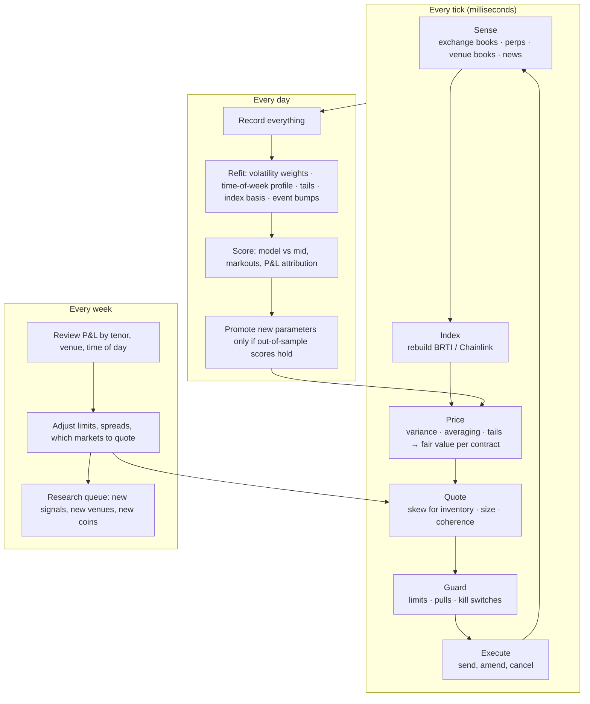

# 5. How the System Works and How to Build It

A mental model of a live crypto prediction-market making system: what it does every second, every day and every week, what data and tools it needs, and the order to build it in. This assumes institutional technology and data access (as PinPredict has through Pinnacle), so it stays at the level of components and decisions rather than code.

---

## 5.1 The mental model: one loop, three speeds

The system is one loop run at three speeds. The fast loop prices and quotes. The daily loop refits the model. The weekly loop decides what to trade and how much.

### What happens on one tick

1. **Sense.** A trade prints on Coinbase, or the Binance perp jumps, or a watched account posts on X.
2. **Index.** The BRTI replica updates (every 200 ms, or immediately on a large move). So does the Chainlink replica for Polymarket.
3. **Price.** For every live contract, fair value is recomputed from the new index level, the variance left until its expiry, and the tail shape. It is closed-form arithmetic, microseconds per contract.
4. **Quote.** Each quote is fair value shaded for inventory, sized by how likely it is to be picked off, and checked so the ladder stays consistent (prices fall with strike; buckets sum to one).
5. **Guard.** Pull quotes if the perp has moved more than the edge, if a news alert fired, if a feed is stale, or if a limit is close.
6. **Execute.** Send only the changes to the venue.

### What happens each day

Overnight, the system refits on a trailing window:
- volatility-forecast weights
- the time-of-week profile
- tail parameters
- the proxy-to-index basis
- event bumps

It then scores yesterday on three questions. Did fair value track the market and outcomes? Did fills lose money in the seconds after (markouts)? Where did P&L come from? New parameters go live only if they hold up out of sample. This repo's `scripts/run_studies.py` is the research version of that daily job.

---

## 5.2 The components

| Component | Job | Build or reuse |
|---|---|---|
| **Market data handlers** | Live order books from the 7 BRTI exchanges, the perps, Deribit, Kalshi and Polymarket | Reuse Pinnacle's feed infrastructure; add crypto venue adapters |
| **Index replicas** | Rebuild BRTI (and Chainlink for Polymarket) and track the live basis between them | Build; small, central and testable against Kalshi's own BRTI stream |
| **Pricer** | Variance forecast, averaging, tails, every contract type from one distribution; Monte Carlo for touch markets | Build. This repo's `model/` is the reference implementation |
| **Quote engine** | Inventory skew, pick-off-aware sizing, ladder coherence, event widening | Build on the sports desk's quoting framework |
| **News engine** | X and wire ingestion, classification, defense triggers | Build the classifier; license the data |
| **Risk system** | One position book per underlying across venues; limits; net-delta hedging in perps (options for long tenors); kill switches | Reuse the firm's risk stack; add payoff-vector books per expiry |
| **Order gateways** | Kalshi (FIX, REST, WebSocket, order groups) and Polymarket (signed CLOB orders) | Reuse or extend existing venue connectivity |
| **Tick store and replay** | Record every message; replay through the system with realistic fills | Reuse firm infrastructure; add a fill and queue model for these venues |
| **Research and monitoring** | Nightly refits, calibration reports, dashboards, alerts | Python research stack plus the firm's monitoring |

---

## 5.3 The data

| Data | Why | Access |
|---|---|---|
| Order books of the 7 BRTI exchanges (Coinbase, Kraken, Bitstamp, Gemini, LMAX Digital, Bullish, Crypto.com) | Rebuild the settlement index | Free exchange WebSockets |
| Kalshi live BRTI stream (`cfbenchmarks_value`) | Ground truth for the replica | Kalshi API key with entitlement |
| CF Benchmarks BRTI history | Exact index for research | Paid licence |
| Chainlink BTC/USD streams | Polymarket's settlement source | Chainlink Data Streams access |
| Kalshi and Polymarket books, trades, fills | Quoting, markouts, crowd behavior | Venue APIs (free; trading needs membership) |
| Perp trades, books, funding, OI, liquidations (Binance, Bybit, OKX, Hyperliquid) | Quote protection, hedging, cascade detection | Free WebSockets; Coinglass or similar for aggregates |
| Deribit options and DVOL | Volatility level, smile and skew for daily and longer tenors | Free live; history from Tardis.dev or Amberdata |
| Historical order books (Tardis.dev, Kaiko) | Replay testing | Paid |
| Macro calendar (BLS, Federal Reserve) | Event variance bumps | Free |
| X enterprise stream, news wires, Truth Social | News defense | Negotiated licence |
| On-chain and flow data (Glassnode, CryptoQuant, ETF flows), social analytics (Santiment, Kaito) | Long-dated crowd and regime research | Paid |

---

## 5.4 Build order

Each phase ends with a measured gate. The system moves on only when the number holds.

| Phase | What gets built | Gate to move on |
|---|---|---|
| **0. Research prototype** *(this repo, done)* | Data pipeline, pricing model, out-of-sample studies | Model ties the Kalshi mid on hourly and beats public approaches ✓ |
| **1. Live shadow** | Feeds, BRTI replica, pricer running live with no orders, tick recording | Replica within 0.5 bp of Kalshi's BRTI stream; live model-vs-mid matches the backtest |
| **2. Hourly and daily quoting** | Quote engine, gateways, risk book, kill switches, perp hedger, news defense v1 | Positive spread capture net of markouts over enough expiries to be significant |
| **3. 15-minute quoting** | Sub-second variance read, perp-lead pulls, in-window averaging math, low-latency placement | 15-minute gap to mid under 1¢ in shadow; pick-off losses below spread capture in replay |
| **4. Long-dated and touch** | Options-implied pricing, Monte Carlo for touch markets, options hedging, crowd-error model | Options-hedged relative value clears fees and capital cost in replay |
| **5. Polymarket and more coins** | Chainlink and Binance replicas, basis models, Polymarket US; ETH and SOL via beta | Per-venue calibration holds |
| **6. Scale** | Bid for Kalshi liquidity-provider slots (2 on crypto 15-minute, 1 on hourly/daily, auctioned [Source]); cross-venue netting | LP economics clear the auction price |

**Why this order:**
- Hourly and daily markets come first because the model already ties the market there, the latency bar is lower, and retail flow concentrates there.
- 15-minute markets wait for the sub-second index and volatility read, because that is where the model currently trails.

---

## 5.5 Operating rules

- **Fair value and views stay separate.** The quote center comes from the model. Crowd-error leans and news defense adjust size and placement, and each is logged separately.
- **Nothing goes live without an out-of-sample score.** That applies to new parameters, new signals and new venues.
- **The expiry is the unit of evaluation.** Fills within one expiry are correlated.
- **Pre-scheduled risk is handled before it happens.** Widen before CPI, payrolls and FOMC. Handle the Thursday 3–5 AM ET pause and DST changes.
- **Every kill switch has an owner and a runbook.** Triggers: index divergence, stale feeds, clock drift, volatility far above the model, drawdown, news alerts.

---

## 5.6 People

| Role | Owns |
|---|---|
| Quant researcher | Model, calibration, refits, signal research |
| Engineer | Feeds, index replicas, gateways, latency |
| Trader / risk owner | Limits, event playbook, kill decisions, venue relationships and LP programs |
| Shared with the sports desk | Treasury, compliance (CFTC rules, venue agreements), monitoring |
