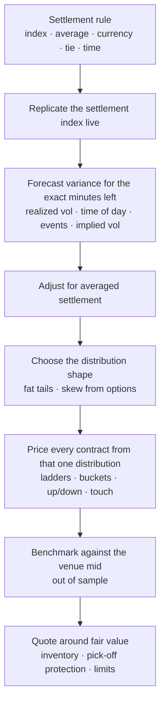

# How to Price Crypto Prediction Markets

A plain-language framework for finding fair value in crypto event contracts on Kalshi, Polymarket and similar venues, at every tenor from 5 minutes to a year.

Companion documents:
- [`SENTIMENT.md`](SENTIMENT.md): where sentiment can and cannot be an edge, and how to test it.
- [`IMPLEMENTATION.md`](IMPLEMENTATION.md): how to build this out with institutional data and technology, and the roadmap.
- [`memo.html`](memo.html): the submitted memo, with the out-of-sample test results.
- [`RESEARCH_OUTLINE.md`](RESEARCH_OUTLINE.md): the underlying research notes and sources.

Evidence tags used throughout:
- **[Tested]** measured in this repo's calibration study (`scripts/calibrate.py`, results in `docs/results/calibration.json`)
- **[Source]** from a rulebook, venue documentation or a published paper
- **[Hypothesis]** reasoned but not yet tested here

---

## 1. The one idea everything rests on

A crypto prediction contract that pays $1 if BTC settles above a level is a **digital option**. Its fair value is **the probability that the settlement value ends above that level**, priced under a distribution that a hedger could defend.

That probability depends on three things:

1. **Distance.** How far is the current settlement index from the strike?
2. **Room to move.** How much can the index still move before settlement? This is volatility × √(time left), adjusted for how the contract settles.
3. **Shape.** How are moves distributed? Crypto has fat tails: most moves are small, and a few are very large.

Every other input matters only through one of these three, almost always through #2. Funding rates, open interest, options implied vol and sentiment are not "weights" added to the price. They are evidence about how much the index can move, or about how fat the tails are. The one exception, covered in [`SENTIMENT.md`](SENTIMENT.md), is very long-dated markets. There, a directional view and the crowd's own biases can matter.

---

## 2. Read the settlement rule before anything else

Most mispricing on these venues comes from pricing the wrong thing. Before modeling, answer these questions for each contract:

| Question | Why it matters | Example |
|---|---|---|
| Which index? | Different indices can sit several basis points apart at the same moment | Kalshi uses CF Benchmarks BRTI; Polymarket's 15-min markets use a Chainlink TWAP; Polymarket hourly uses a Binance BTC/USDT candle [Source] |
| Average or point print? | An average removes variance in the final window and makes the contract harder to manipulate | Kalshi settles on the mean of 60 one-second BRTI prints [Source] |
| Quote currency? | USDT and USD differ by a small, moving basis | Binance BTC/USDT ran about +5 bp above BRTI in our sample [Tested] |
| Tie rule? | It decides who wins when the average lands exactly on the strike | Kalshi 15-min pays YES on a tie (≥) [Source] |
| Strike convention? | Strikes like 79,999.99 mean "≥ 80,000" in practice | Kalshi ladders list X − 0.01 [Source] |
| Barrier monitoring? | "Touch" markets differ by how a touch is measured | Kalshi max/min markets use a per-minute 20%-trimmed mean, so a wick under about 12 seconds cannot trigger them [Source] |
| Timezone and pauses? | Contracts are defined in ET, data arrives in UTC, and DST shifts the mapping | Kalshi pauses Thursdays 3–5 AM ET [Source] |
| Reference for the start price? | Up/down markets need to know what "start" means | Kalshi's 15-min strike equals the prior window's settlement, verified on 27,093 windows [Tested]. Polymarket's start-price convention is still to be confirmed |

**Rule:** price the exact index, sampled the exact way, at the exact time, in the exact currency the contract settles on.

---

## 3. The general pricing recipe

The same seven steps apply to every crypto event contract:

1. **Replicate the settlement index.** For Kalshi, rebuild BRTI from its seven constituent USD exchanges. For Polymarket, read Chainlink or Binance directly. In our sample, a free proxy (the median of Coinbase and Bitstamp one-minute closes) tracked BRTI with a median error of 1.2 bp [Tested].
2. **Forecast variance over the minutes left.** Use recent realized variance at several horizons, multiplied by the expected pattern for those exact minutes (time of day, day of week, scheduled releases), and blended with options-implied vol. A 15-minute window at 10 AM ET carries about 3× the variance of one at 3 AM [Tested].
3. **Adjust for averaging.** With a 60-second average, the final minute contributes about a third of a point print's variance. Remove 0.658 of the last minute's variance before the window opens. Inside the window, the prints already locked in define an effective strike for the rest [Tested + derivation].
4. **Choose the shape.** Use a Student-t with about 4–4.5 degrees of freedom instead of a normal. BTC's standardized 15-minute returns have excess kurtosis near 10 [Tested]. For weekly and longer tenors, take the shape from the options smile.
5. **Price everything from one distribution.** Ladders, range buckets, up/down and touch markets on the same index should all come from the same terminal distribution. Then digitals fall monotonically with strike and buckets sum to one, so nobody can arbitrage your quotes against each other.
6. **Benchmark against the venue mid, out of sample.** Matching the market's accuracy is what lets you quote safely. Beating it is a bonus.
7. **Quote around fair value.** Shade for inventory. Pull quotes when a faster feed (the perp) says fair value moved. Cap the total exposure a single price gap can sweep.

**Drift is zero at short horizons.** BRTI is built to behave like a martingale, and funding, OI and sentiment show no credible directional signal under an hour [Source; earlier check: funding vs next-8h return correlation −0.02]. At long horizons this changes; see section 5.

---

## 4. Different tenors look at different things

The recipe is the same everywhere, but which input dominates changes with time to expiry.

| Tenor | What sets the price | What matters most | Main risk to a market maker | Where an edge can come from |
|---|---|---|---|---|
| **5- and 15-minute** up/down | Index vs start price, and sub-second index moves | Exact index replication, fast realized vol, settlement averaging in the final minutes | Getting picked off by traders who read the index faster | Speed of cancels, exact settlement math, LP rewards. Our 1-minute model trails the mid by about 4¢ here, consistent with index measurement error [Tested] |
| **Hourly** ladders | Distance in σ units over the hour | The variance forecast, including the time-of-day profile and scheduled events (CPI 8:30 ET, FOMC 2:00 ET) | One price gap fills every strike on the way | Seasonal vol plus fat tails. Our model ties the mid [Tested] |
| **Daily** ladders | The 24-hour variance level and the tails | Implied vol (DVOL carries its largest weight here), tail shape, overnight and weekend gaps | Overnight jumps | Fat-tailed pricing of far strikes, retail flow. Our model slightly beats the mid, on a small sample [Tested] |
| **Weekly / monthly** | The options-implied distribution | The Deribit smile and skew; the jump and event calendar | Vol-regime shifts; event risk (ETF, macro, regulation) | Relative value against options, positioning and sentiment-driven mispricing [Hypothesis] |
| **Quarterly / yearly** (e.g., "BTC above $150k on Dec 31") | Risk-neutral distribution from options, discounting, and the crowd | Long-dated implied vol and skew, interest on capital, narratives | Capital locked for months; crowd conviction can persist | Options-hedged relative value; selling overpriced narrative longshots [Hypothesis] |
| **Touch / barrier** ("BTC hits $X this month") | Path probability, not terminal | Vol, vol-of-vol, jumps, the exact monitoring rule | Gap through the barrier | Monitoring-rule details; the crowd's tendency to overprice touches [Hypothesis] |
| **Range buckets** | Density between two strikes | Distribution shape near the money | Thin books | Correct peakedness: fat tails mean near-money buckets are worth more than a normal implies [Tested direction] |

### How the inputs shift across tenors (in our fitted model)

The variance forecast is a regression on realized variance and implied vol. Its weights move toward slower inputs as the horizon grows [Tested, log-HAR elasticities]:

| Input | Weight, next 1 hour | Weight, next 24 hours |
|---|---|---|
| Realized variance, last 1 hour | 0.52 | 0.17 |
| Realized variance, last 24 hours | 0.35 | 0.38 |
| Realized variance, last 7 days | 0.01 | 0.14 |
| Deribit DVOL (30-day implied) | 0.30 | 0.40 |

Past a few days, the options market should take over entirely, because it prices the full distribution for that exact horizon.

### Short tenors are a measurement problem; long tenors are a distribution problem

- At **15 minutes**, an at-the-money contract moves about 3¢ for every basis point BTC moves with 5 minutes left. Being 1 bp wrong about the index costs more than any modeling choice.
- At **one day**, the same 1 bp barely matters (about 0.15¢). What matters is whether your distribution has the right width and tails.
- At **one year**, the distribution comes from options. The question becomes whether the crowd's price departs from it, and why.

---

## 5. Long-dated markets: risk-neutral vs real-world

For contracts expiring in weeks or months, there are two different "probabilities":

- **Risk-neutral (options-implied):** the price at which the contract can be **replicated and hedged** with options. A Kalshi "BTC above K on date T" contract is close to a tight Deribit call spread around K for the same date. You can read the digital price off the smile as the negative slope of the call price in strike (Breeden–Litzenberger), with a skew correction: digital = N(d₂) − vega × ∂σ/∂K.
- **Real-world (physical):** the actual probability of the event. It differs from risk-neutral because option buyers pay risk premia, for example for crash protection.

For a **market maker who hedges**, fair value is the risk-neutral price plus the cost of carrying and hedging the position. That makes long-dated event contracts an **options relative-value trade**:

1. Price the contract from the Deribit smile, interpolated in total variance to the contract's exact settlement time. Deribit expires at 08:00 UTC on a 30-minute TWAP; Kalshi's daily settles at 5 PM ET on a 60-second BRTI average [Source]. So the hedge is close, not exact.
2. Adjust for **capital and discounting.** A year-dated contract ties up capital, and if a venue pays interest on balances, that changes the break-even. Price = discount factor × probability, plus or minus the funding cost of the hedge.
3. Adjust for **venue frictions:** fees, position limits ($25k per strike on Kalshi [Source]), and the fact that most participants cannot or will not hedge in options.
4. If the venue price departs from the hedged fair value by more than those frictions, **trade the gap and hedge it with options or perps.**

This is where the crowd's views, and therefore sentiment, can matter. Retail buyers of "BTC to $200k this year" are not pricing a risk-neutral distribution. They are expressing a narrative, and arbitrage capital is scarce because it is locked up for months. See [`SENTIMENT.md`](SENTIMENT.md).

### Touch markets

"Does BTC hit $X before date T" is a barrier digital. With zero drift and continuous monitoring, the reflection principle gives P(touch) ≈ 2 × P(finish above X), so touches are worth roughly twice the matching terminal digital. Real pricing needs three corrections:

- **Discrete, trimmed monitoring.** A wick that doesn't move a trimmed one-minute mean doesn't count. That lowers the touch probability (the Broadie–Glasserman–Kou shift; about a 1-point effect at these tenors) [Source].
- **Skew and jumps.** Fat tails and vol-of-vol raise touch probabilities far from spot.
- **Vol path.** Price by Monte Carlo under a model calibrated to the smile, applying the venue's exact monitoring rule.

---

## 6. Different venues look at different things

| Venue | Settlement source | What that implies for pricing |
|---|---|---|
| **Kalshi** | CF Benchmarks BRTI, 60-second average | Build a BRTI replica from the seven constituent USD books. Validate against Kalshi's own BRTI stream (`cfbenchmarks_value`) |
| **Polymarket (international)** | Chainlink 60-second TWAP (5m, 15m, 4h); Binance BTC/USDT candle (hourly, daily) [Source] | A separate engine: price on Chainlink or Binance and model the basis to BRTI. Binance point prints are easier to push, so widen near the close. US persons cannot trade this venue |
| **Polymarket US** | Reportedly BRTI [Source, to confirm] | Likely shares the Kalshi engine |
| **ForecastEx (IBKR)** | CF RTI, 60-second averages [Source] | Economically the same as Kalshi 15-min; same engine |
| **Crypto.com / CDNA** | Its own trimmed 60-second index [Source] | Needs its own replica |
| **Deribit, perps** | Not prediction markets; hedge and information venues | Deribit gives the vol surface; perps give the price lead (about 100–300 ms ahead of spot) and the cheapest delta hedge |

**One engine, many replicas.** The variance forecast and distribution are shared. Each venue gets its own index replica and a basis model between replicas. This lets a single risk book net positions across venues on nearly the same underlying.

---

## 7. How the industry does this

What is public about the participants [Source]:
- **Designated market makers.** SIG has been Kalshi's first designated market maker since 2024 and runs a dedicated predictions desk.
- **Other names.** Jump, Wintermute, DRW and exchange-affiliated desks have been reported in the space.
- **LP slots.** Kalshi runs a liquidity-provider program with auctioned slots: 2 on crypto 15-minute markets, 1 on hourly/daily.
- **Maker profits.** Studies of Polymarket and Kalshi find that makers, not takers, earn the money. One week of Polymarket 15-minute data shows makers at about +0.48% of volume before rebates, while takers lost despite a 53% win rate.

Firms don't publish their internals. Based on how options market makers work in general, the playbook is almost certainly this [Hypothesis, but standard practice]:

1. **Treat it as an options book.** Event contracts are digitals. Price them off a volatility surface, risk them in Greeks, and net them against options and perps.
2. **Own the settlement index.** Replicate it faster and more exactly than anyone else.
3. **Be fast defensively.** Speed protects resting quotes from pick-off. Taker latency arbitrage has largely been competed away.
4. **Make money from flow and programs.** Spread capture against retail, LP rewards and fee rebates, not directional bets.
5. **Net everything in one book.** Short-tenor contracts roll into longer ones. Hedge the book's net delta, not each contract.
6. **Validate constantly.** Track model vs mid, markouts after each fill, and index residuals every day.

---

## 8. What is tested here and what isn't

| Claim | Status |
|---|---|
| Free USD proxy tracks Kalshi's BRTI settlement to about 1 bp | [Tested] n = 7,816 hours |
| Fat-tailed (t) pricing beats a normal at every tenor | [Tested] out of sample |
| Averaging adjustment matters in the final 3 minutes only | [Tested] |
| Model ties the Kalshi mid on hourly and slightly beats it on daily | [Tested] (daily on 104 events; interval includes zero) |
| Model trails the mid on 15-minute because of index measurement | Gap [Tested]; cause [Hypothesis] |
| Kalshi mid overprices 0.5–1.5σ longshots by about 2¢ | [Tested] |
| Funding has no short-horizon directional signal | Earlier check, not in this study |
| Sentiment helps price long-dated markets | [Hypothesis]; test design in [`SENTIMENT.md`](SENTIMENT.md) |
| Options-implied pricing of weekly/yearly contracts | [Hypothesis]; not yet tested |
| Polymarket engine and Chainlink basis | Not yet tested |
