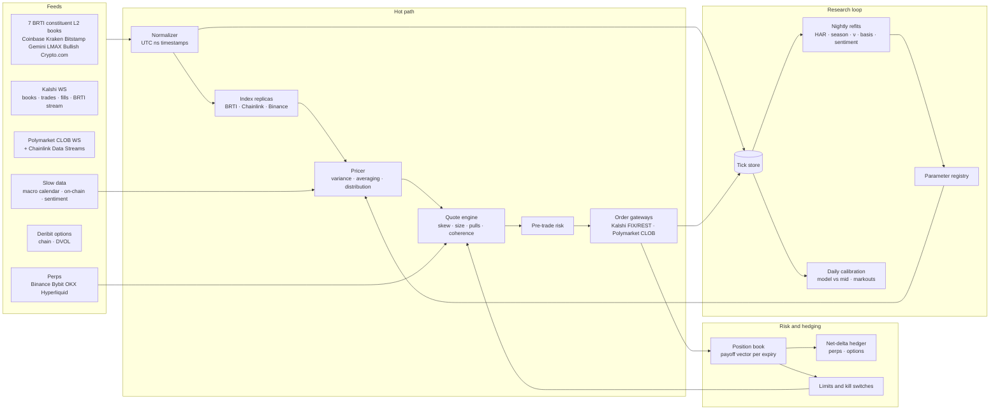

# Implementation and Roadmap

How to turn the framework in [`FRAMEWORK.md`](FRAMEWORK.md) into a production pricing and market-making system. This assumes the firm has institutional data, technology and venue access, and names what each piece needs. Sports infrastructure that PinPredict already runs (venue connectivity, risk, treasury) is reused where possible.

---

## 1. System architecture

**Design principles**
- **The hot path is deterministic and replayable.** Every decision can be reproduced from recorded inputs, so live behavior and backtests match.
- **Pricing is cheap; data is the bottleneck.** The closed-form pricer runs in microseconds. Latency budget goes to feed handling, index replication and order round-trips.
- **Parameters are slow, prices are fast.** Volatility weights, the seasonal profile, the tail parameter and the basis models refit nightly. The hot path only reads them.
- **One book per underlying.** Every Kalshi, Polymarket and hedge position on BTC rolls up into one risk view.

---

## 2. Components

| Component | Job | Suggested technology | In this repo today |
|---|---|---|---|
| **Feed handlers** | Connect to each venue WebSocket, maintain L2 books, detect gaps and staleness | Rust or C++, one handler per venue, kernel-bypass networking if colocated | Historical REST and bulk pulls only (`src/pinpricer/data/`) |
| **Normalizer and bus** | One message format, nanosecond UTC receive timestamps, fan-out to consumers | Aeron or a shared-memory ring buffer on the hot path; Kafka or NATS for everything else | – |
| **Index replicas** | BRTI rebuilt every 200 ms from constituent books (CF Benchmarks method: size-capped levels, depth-weighted mid, stale and outlier books dropped). Chainlink and Binance references for Polymarket. Live basis between them | Rust, inside the pricer process | 1-minute proxy (`model/vol.py: proxy_minutes`) |
| **Variance engine** | Realized variance at several horizons, seasonal profile, event bumps, DVOL blend, jump intensity | Rust hot path reading nightly-fit parameters | `model/vol.py: VolModel` |
| **Pricer** | Averaging adjustment, partial-average strike in the final minute, Student-t or smile-implied distribution, every contract type from one distribution, Monte Carlo for touch markets | Rust; Monte Carlo off the hot path, cached per expiry | `model/fv.py` |
| **Quote engine** | Inventory skew, pick-off-aware sizing, pulls on perp moves, ladder coherence projection, event widening | Rust | Designed (memo §Market making); not built |
| **Order gateways** | Kalshi FIX/REST/WebSocket with order groups; Polymarket CLOB with signed orders and heartbeat | Rust or the firm's existing gateway framework | – |
| **Risk and hedging** | Payoff-vector book per expiry, limits, net-delta hedging in perps (options for long tenors), kill switches | Existing firm risk stack plus a crypto adapter | Designed; not built |
| **Tick store** | Every feed message, book state, order and fill | kdb+, ClickHouse, or Parquet on object storage | Parquet partitions (`data/raw/`) |
| **Research and refits** | Nightly parameter fits, calibration reports, ablations, sentiment studies | Python (pandas, numpy, scipy, statsmodels), orchestrated by Dagster or Airflow; MLflow or a simple versioned registry | `scripts/calibrate.py` |
| **Replay simulator** | Feed recorded data through the hot path with a queue-position and latency model to estimate maker P&L | Rust core with Python bindings | – |
| **Monitoring** | Model vs book per strike, index residuals, latency percentiles, inventory, P&L by tenor, alerts | Prometheus and Grafana; paging for kill events | – |

---

## 3. Data: what to buy, what's free, and what it feeds

| Data | Source | Cost | Feeds | Why |
|---|---|---|---|---|
| Constituent spot L2 books | Direct exchange WebSockets | Free (infrastructure cost only) | Index replica | BRTI is computed from these |
| Real-time BRTI | Kalshi `cfbenchmarks_value` stream; CF Benchmarks license | Entitlement to confirm; license is paid | Replica validation | Ground truth for the settlement index |
| Historical BRTI | CF Benchmarks | Paid | Research | Exact labels for every minute, not only settlements |
| Chainlink BTC/USD | Chainlink Data Streams | Access required | Polymarket replica | Polymarket's short-market settlement source |
| Perp trades, books, funding, OI, liquidations | Exchange WebSockets; Coinglass for aggregates | Free / paid | Quote protection, jump intensity | Perps lead spot by about 100–300 ms |
| Options chain and smile | Deribit WebSocket (live, free); Tardis.dev or Amberdata (history, paid) | Free live / paid history | Daily and longer tenors, sentiment (skew) | Risk-neutral distribution for long-dated contracts |
| Historical L2 for replay | Tardis.dev, Kaiko | Paid | Replay simulator | Realistic fill and queue modeling |
| Venue history | Kalshi and Polymarket APIs; Polymarket on-chain data | Free | Calibration, flow signals | Labels and the crowd's behavior |
| Macro calendar | BLS, Federal Reserve, a calendar vendor | Free / paid | Event variance bumps | CPI, NFP and FOMC move short-tenor variance by 1.5–2.5× [Source, to fit] |
| On-chain and flow | Glassnode, CryptoQuant, ETF flow data | Paid | Long-tenor regime signals | See [`SENTIMENT.md`](SENTIMENT.md) |
| Social, attention, news | Santiment, LunarCrush, The TIE, Kaito, Google Trends; LLM headline classification | Paid / free | Variance input; long-tenor crowd model | Volume predicts vol; tone is a hypothesis |

---

## 4. Latency budget (target, 15-minute markets)

| Step | Target |
|---|---|
| Exchange message → normalized event | < 1 ms in process |
| Index replica update | every 200 ms, plus on large constituent moves |
| Perp move → fair value update | < 1 ms |
| Fair value change → cancel sent | < 5 ms in process |
| Cancel → venue acknowledgement | Venue round-trip; measure and colocate to minimize. Must beat Polymarket's 150 ms taker delay by a wide margin |

Hourly and daily markets tolerate far more. Their fair value moves about 0.75¢ and 0.15¢ per bp of BTC, against about 1.5¢ for 15-minute contracts and 5.8¢ inside the final minute [derivation in `RESEARCH_OUTLINE.md`].

---

## 5. Daily operating loop

1. **Overnight:** refit the variance weights, seasonal profile, tail parameter, index basis and blend weights on a trailing window. Run the calibration report. Promote new parameters only if out-of-sample scores hold.
2. **Pre-market:** load the day's event calendar. Set widening and blackout windows around releases. Confirm feed health and the replica-vs-BRTI residual.
3. **Live:** price on every tick, quote, hedge net delta in bands, enforce limits. Alert on index divergence, latency spikes or realized vol above k× the model.
4. **Post-trade:** markouts at 100 ms, 1 s, 10 s and 60 s for every fill. P&L split into spread capture, adverse selection, rebates, fees and hedge cost, by tenor and venue.

---

## 6. Roadmap

Each phase has a gate: a measured number that must hold before moving on.

| Phase | Work | Gate |
|---|---|---|
| **0. Research prototype** *(done, this repo)* | Data pipeline; fair-value engine v0–v4; out-of-sample test vs Kalshi | Model ties or beats the mid on hourly and daily ✓ |
| **1. Live data and shadow pricing** | Feed handlers for the seven BRTI constituents, Kalshi WebSocket and BRTI stream, perps, Deribit. Tick store. Run the pricer live with no orders | Replica residual to Kalshi's BRTI under 0.5 bp. Live model vs mid matches the backtest |
| **2. Quote hourly and daily** | Quote engine, gateways, risk book, kill switches, net-delta hedger. Small size | Positive spread capture net of markouts over enough expiries to be significant |
| **3. Quote 15-minute** | Sub-second replica, perp-lead pulls, partial-average strike, colocation | 15-minute gap to mid under 1¢ in shadow. Pick-off loss below spread capture in replay |
| **4. Longer tenors** | Options-implied pricing for weekly, monthly and yearly contracts; touch markets by Monte Carlo; options hedging | Options-hedged relative value clears fees and capital cost in replay |
| **5. Sentiment and crowd model** | Venue-flow, skew, funding and attention signals; pre-registered test from [`SENTIMENT.md`](SENTIMENT.md) | Out-of-sample, per-expiry P&L improvement over the options-plus-constant-bias baseline |
| **6. Polymarket and more assets** | Chainlink and Binance replicas, basis model, Polymarket US onboarding; ETH, SOL and others | Basis model validated; per-venue calibration holds |
| **7. LP programs and scale** | Bid for Kalshi LP slots; Polymarket rebates; cross-venue netting | LP economics clear the auction price |

---

## 7. Team

| Role | Owns |
|---|---|
| Quant researcher | Models, calibration, parameter refits, sentiment studies |
| Low-latency engineer | Feed handlers, index replicas, gateways, latency |
| Trader / risk owner | Limits, event playbook, kill decisions, venue relations, LP program |
| Shared with sports desk | Treasury, compliance (CFTC rules, Kalshi member and LP agreements, CFTC staff advisory 26-23), monitoring infrastructure |

---

## 8. Key risks to the build

| Risk | Mitigation |
|---|---|
| The BRTI stream entitlement isn't available | Rebuild BRTI from constituents. License CF Benchmarks data if the replica residual can't reach the gate |
| Faster competitors in 15-minute markets | Start with hourly and daily, where the model already ties the mid and retail flow concentrates |
| Index or oracle divergence (Chainlink vs BRTI vs Binance) | Live basis model; kill switch on divergence |
| Settlement-window manipulation in thin hours and alt series | Widen in thin hours; cap size near the close on point-print markets |
| Overfit sentiment signals | Pre-registration, walk-forward testing, expiry-level statistics |
| Regulatory change to MM programs | Track CFTC advisories; don't depend on any single program's rewards |
