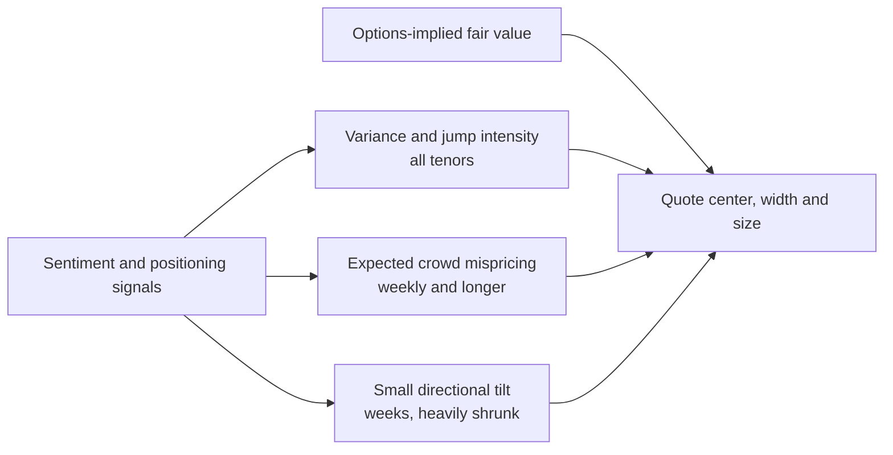

# Sentiment as an Edge in Longer-Dated Crypto Markets

Where sentiment belongs in a crypto prediction-market pricer, where it doesn't, and how to test it before trusting it. Tags follow [`FRAMEWORK.md`](FRAMEWORK.md): [Tested], [Source], [Hypothesis].

---

## 1. The short answer

- **Under about a day, sentiment is not a price signal.** At 15-minute and hourly horizons there is no credible evidence that sentiment, funding, OI or social data predict the direction of BTC. Using them as drift adds noise to fair value. Their legitimate use there is as a **volatility and jump-risk input** and for **quote protection** [Source; earlier funding check −0.02 correlation].
- **At weeks to months, sentiment can be an edge, mostly through the crowd rather than through BTC.** The strongest case is not "sentiment predicts where BTC goes". It is "sentiment predicts **how wrong the prediction-market price is** relative to a hedgeable, options-implied fair value, and when that error will close" [Hypothesis].

So there are three distinct ways sentiment can enter, in order of confidence:

| Channel | What sentiment predicts | Horizon | Confidence |
|---|---|---|---|
| A. Volatility and jumps | How much BTC will move, not which way | All tenors | Supported: social-media volume predicts trading volume and realized vol, not returns (Shen, Urquhart & Wang, 2019) [Source] |
| B. Crowd mispricing | The gap between the venue price and options-implied fair value | Weekly to yearly | [Hypothesis], with a clear mechanism; the favorite-longshot bias it builds on is documented on Kalshi (Bürgi, Deng & Whelan) [Source] |
| C. Direction | BTC's real-world return | Weeks | Weak and contested. Investor attention (Google searches) and time-series momentum showed predictive power at 1–8 week horizons (Liu & Tsyvinski, 2021) [Source]; small, regime-dependent, and easy to overfit |

---

## 2. Why the crowd can be wrong for longer in long-dated markets

In a 15-minute market, mispricing is corrected in seconds by fast bots. A year-dated "BTC above $150k on Dec 31" contract is different:

1. **Arbitrage capital is scarce.** Correcting the price ties up capital for months. Most participants can't hedge with options, and position limits cap how much any one firm can lean against the crowd ($25k per strike on Kalshi [Source]).
2. **Buyers express narratives, not distributions.** Retail buys "BTC to $200k" because of a story (ETF flows, halving, a political event), not because they priced a risk-neutral density.
3. **Longshots are systematically overpriced.** Contracts under 10¢ lose more than 60% for buyers on Kalshi (Bürgi, Deng & Whelan) [Source]. People overweight small probabilities (Snowberg & Wolfers, 2010) [Source]. In our own short-tenor data, the Kalshi mid overpriced contracts 0.5–1.5σ out of the money by about 2¢ relative to what they paid [Tested].
4. **Euphoria and fear move that bias.** When sentiment is euphoric, demand concentrates in upside longshots ("BTC hits $X"). When it is fearful, in downside ones. The bias should be largest on the side the crowd is excited about [Hypothesis].

**The edge:** compute a hedgeable fair value from options. Measure the venue's gap to it. Use sentiment to predict which side of the ladder is rich, by how much, and whether the gap will widen or close. Sell the rich side and hedge it with options or perps.

---

## 3. How it fits into the pricer

Sentiment never replaces the pricing core. It adjusts three things, each bounded and each testable on its own:

1. **Variance and jumps (all tenors).** A spike in social volume, liquidations or perp OI raises the variance forecast and the jump intensity. This widens quotes and cuts size. It never shifts the center.
2. **Crowd-mispricing model (weekly and longer).** Expected gap = f(sentiment, side of ladder, distance in σ, time to expiry). Use it to lean quotes: offer the rich side more aggressively and bid the cheap side less. This changes **where you quote relative to fair value**, not fair value itself.
3. **Directional tilt (optional, weeks).** If channel C survives testing, add a small drift μ to the real-world distribution, shrunk heavily toward zero. A desk that hedges in options shouldn't need it; it matters only for unhedged inventory.

Keep the hedged fair value and the sentiment-adjusted quote as separate numbers in the system. Then you always know how much of a position is "model" and how much is "view".

---

## 4. The signals worth testing

Ranked by how directly they measure the crowd in these markets:

| Signal | What it measures | Source | Notes |
|---|---|---|---|
| **The venue's own flow** | Order imbalance, trade-size mix (retail is small), YES/NO buying by strike | Kalshi and Polymarket trades and books; Polymarket on-chain wallet data | The most direct measure of the crowd you trade against |
| **Venue price minus options-implied fair value** | Current mispricing by strike and side | Kalshi/Polymarket books + Deribit surface | The target variable itself; it persists and mean-reverts |
| **Options skew** (25-delta risk reversal, put/call) | How much the options market pays for crash vs rally protection | Deribit; vendors such as Amberdata, Laevitas | Priced sentiment. Cleaner than surveys |
| **Perp positioning** | Funding rate, perp basis, open interest, liquidation clusters | Binance, Bybit, OKX, Hyperliquid; Coinglass | Crowded leverage raises jump risk on the crowded side |
| **Spot demand** | Coinbase premium (US buying), ETF flows, stablecoin issuance | Exchange data; ETF flow trackers; on-chain data (Glassnode, CryptoQuant) | Slow-moving regime indicators |
| **Attention** | Google Trends, Wikipedia views, app-store ranks | Google Trends API, public data | Liu & Tsyvinski's attention measure |
| **Social and news** | Volume and tone on X, Reddit, Telegram; headline classification | Vendors (Santiment, LunarCrush, The TIE, Kaito); LLM classification of news | Volume is more reliable than tone. Tone needs careful labeling |
| **Composite indices** | Fear & Greed style indices | alternative.me and similar | Convenient but opaque; use as a sanity check |

---

## 5. How to test it without fooling yourself

Sentiment research overfits easily: many signals, few independent long-dated expiries, and strong regimes. The test has to be stricter than for the short-tenor pricer.

1. **Fix the target first.** The target is the gap between the venue mid and options-implied fair value, and its change over the next day or week. Not BTC's return.
2. **The statistical unit is the expiry.** Fifty strikes on one yearly contract are not fifty observations. Resample whole expiries for confidence intervals, as the calibration study does.
3. **Pre-register the signals and the model** before looking at test-period results. Keep a short list (venue flow, skew, funding, attention) rather than searching hundreds.
4. **Walk forward.** Fit on the past, score on the next period, roll. Report every fold, not just the good ones.
5. **Beat the right baseline.** The baseline is "options-implied fair value plus a constant longshot-bias correction". Sentiment must add to that, not to a naive model.
6. **Measure in money.** Simulate leaning quotes by the predicted gap, with real fees, position limits and capital costs. Report P&L per expiry and its spread.
7. **Check channel A separately.** Does adding social volume or liquidations to the variance forecast improve out-of-sample realized-vol R²? That is a cheap test with lots of data, and it can run on the repo's existing pipeline.

**What would count as an edge:** a stable, out-of-sample relationship in which more euphoric (or fearful) sentiment predicts a larger overpricing on that side of the ladder, large enough to clear fees and capital costs after hedging.

---

## 6. What we have and what's next

- **Have:** the short-tenor pricing core, the calibration harness, and Kalshi/spot/perp/DVOL data. Our own test confirms the longshot overpricing at short tenors [Tested].
- **Next:**
  1. Pull Kalshi weekly, monthly and yearly BTC markets (above/below, ranges, max/min) and Deribit option-chain history (Tardis.dev).
  2. Build the options-implied fair value for each contract and measure the gap.
  3. Add funding, OI, skew, venue flow and Google Trends, and run the pre-registered test above.
  4. Separately, test social volume and liquidations as variance inputs on the existing hourly data.
